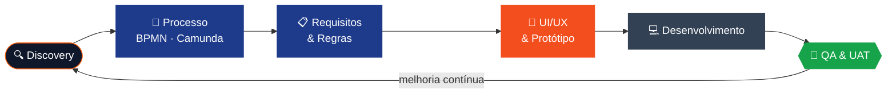

  

  
  
  
  

---

## 👋 Sobre mim

<table>
<tr>
<td width="60%" valign="top">

Sou **Analista Funcional** em produtos digitais de **banca, seguros e saúde**. Faço a ponte entre o negócio e a tecnologia: investigo o problema, modelo o processo, especifico a solução, desenho a experiência e garanto que o que é entregue corresponde ao que foi pedido.

- 🔭 Actualmente na **Selenium – Digital Solutions**
- 🧩 Foco: requisitos claros, processos eficientes e interfaces simples
- 🧪 Acredito que um requisito só está pronto quando é **testável**
- 🌍 Português (nativo) · Inglês

</td>
<td width="40%" valign="top" align="center">

**🏦 Banca** &nbsp;·&nbsp; **🛡️ Seguros** &nbsp;·&nbsp; **🩺 Saúde**

 

| | |
|:--:|:--:|
| **4+** anos | **5** empresas |
| **4** certificações | **∞** user stories |

</td>
</tr>
</table>

## 🧭 O que faço

<table>
<tr>
<td align="center" width="20%"><h3>📋</h3><b>Análise Funcional</b> Requisitos, user stories, regras de negócio, RTM, dicionário de dados</td>
<td align="center" width="20%"><h3>🔀</h3><b>Processos</b> AS-IS / TO-BE em BPMN 2.0 e fluxos executáveis com Camunda</td>
<td align="center" width="20%"><h3>🎨</h3><b>UI/UX</b> Discovery, wireframes, protótipos, design systems, usabilidade</td>
<td align="center" width="20%"><h3>🧪</h3><b>QA</b> Cenários de teste, critérios de aceitação, UAT, gestão de defeitos</td>
<td align="center" width="20%"><h3>🎯</h3><b>Product Owner</b> Backlog, priorização, MVP, alinhamento com stakeholders</td>
</tr>
</table>

## 🔁 Como trabalho

## 🛠️ Ferramentas

  

  
  
  
  
  
  

## 💼 Percurso

| Período | Empresa | Função | Destaques |
|:--|:--|:--|:--|
| **2025 – hoje** | **Selenium – Digital Solutions** | Analista Funcional · Product Designer | App de seguros com participação de sinistros · Portal Empresas com aprovações multinível |
| 2024 – 2025 | Medicare Angola | Analista Funcional · Product Designer | Plataforma de Gestão Interna · Monitorização de Chamadas |
| 2024 – 2025 | Speechcare Center | Analista Funcional · UI/UX Designer | Especificações funcionais, protótipos e validação |
| 2023 – 2024 | SparkTech | Front-end Developer | Interfaces responsivas e integração com REST APIs |
| 2022 – 2024 | Equilibrium, SI | UI/UX Designer | Portal da Saúde · UI kit transversal |

## 🎓 Certificações

  
  
  
  

---

  <i>"Um bom requisito é aquele que o designer consegue desenhar, o developer consegue construir e o QA consegue testar."</i>

